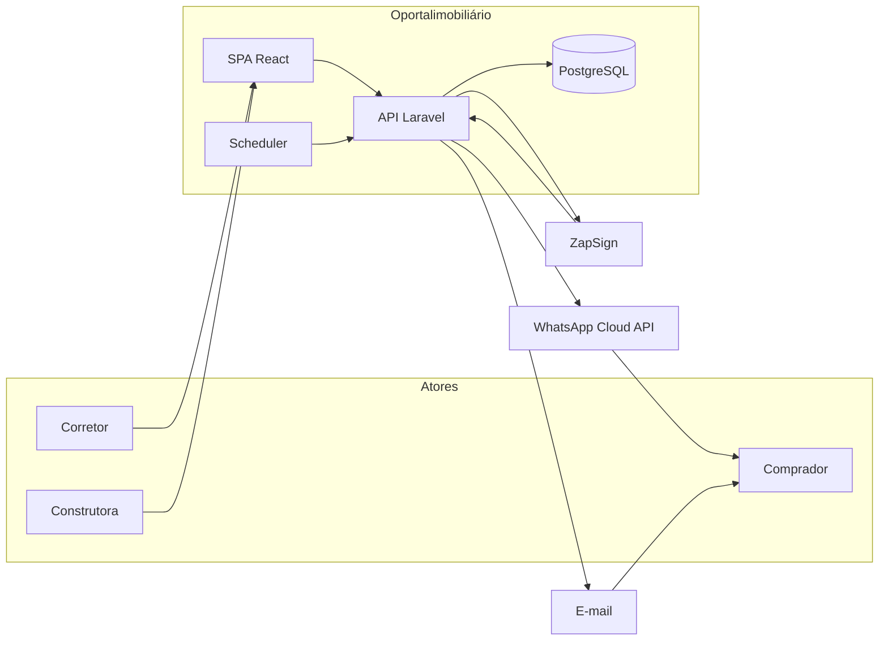
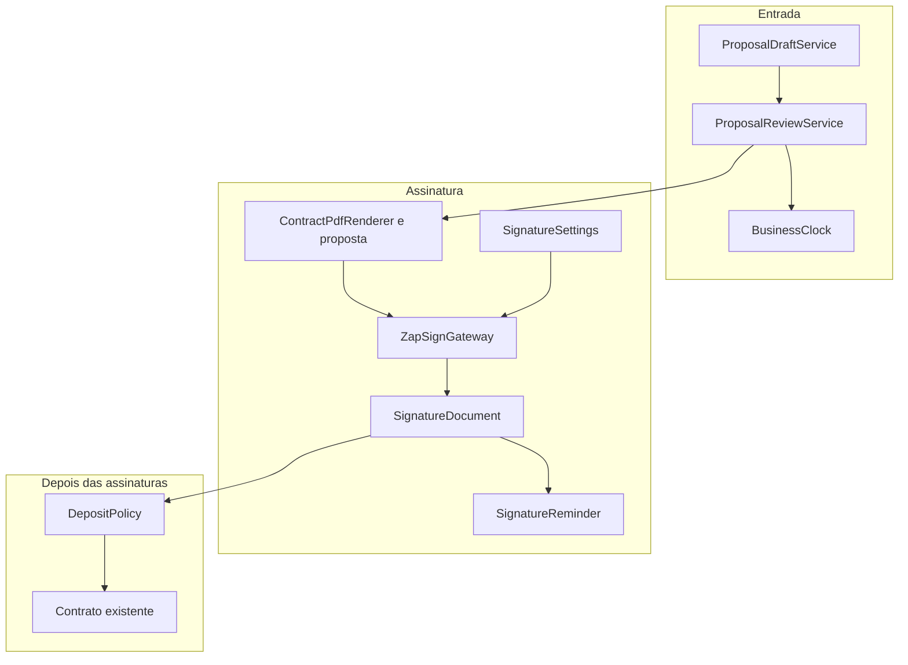
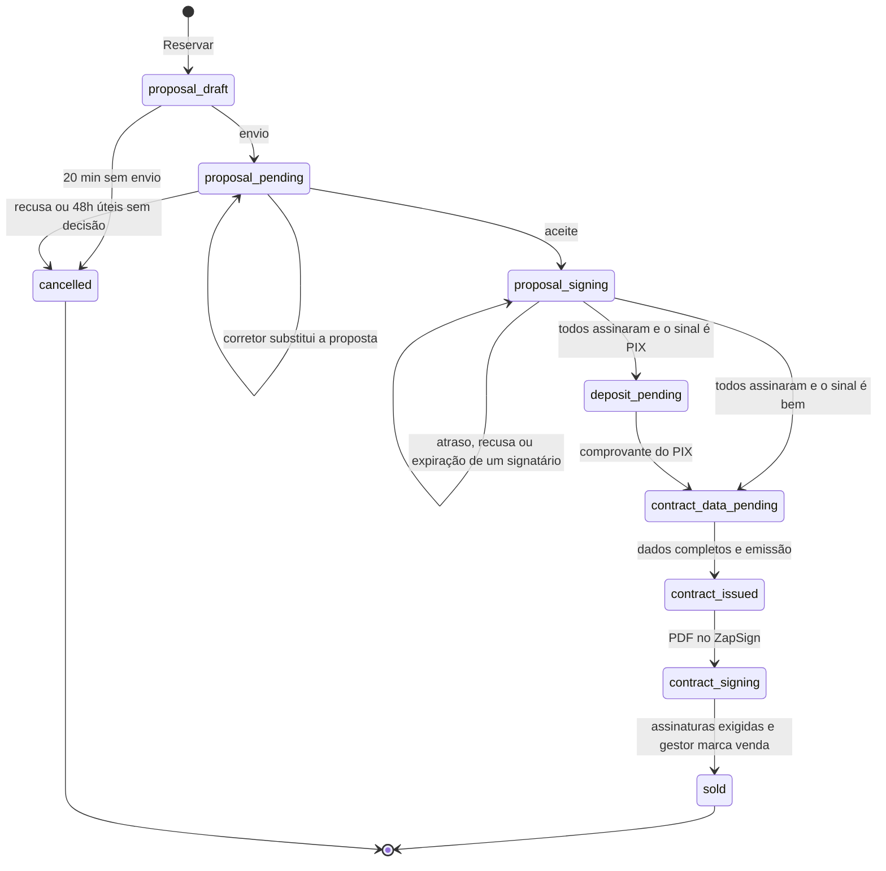

# Design: Reserva direta, proposta e ZapSign

**Fonte**: [docs/discovery/resumo-reserva-direta-proposta-zapsign.md](../../../docs/discovery/resumo-reserva-direta-proposta-zapsign.md)
**Status**: Approved

Arquitetura do fluxo confirmado. Não há implementação neste documento.

---

## Architecture Overview

A reserva continua sendo o agregado. O que muda é a porta de entrada e o que acontece depois do aceite.

O corretor não abre mais uma pré-reserva. O clique em Reservar cria um rascunho de 20 minutos corridos, invisível para a construtora, com a unidade já travada. O envio coloca o card em Proposta em análise e arma um prazo de 48 horas úteis. A construtora só aceita ou recusa. O aceite gera o PDF local e entrega a assinatura ao ZapSign, conta única da plataforma. O sinal em dinheiro só existe depois que todos assinaram a proposta. Sinal em bem, já descrito na proposta, não pede PIX.

A SPA não fala com ZapSign, WhatsApp nem com o relógio de feriados. A API é o único lugar que trava a unidade, calcula prazo e dispara assinatura.

---

## Containers

| Container | Papel neste fluxo |
|-----------|-------------------|
| SPA corretor / construtora | Reservar, preencher proposta, kanban, config geral, botão de reenvio |
| API Laravel | Regras, PDF, prazo, orquestração do ZapSign |
| PostgreSQL | Reserva, proposta, config, documentos de assinatura, feriados |
| Scheduler | Expira rascunho (1 min), expira análise (1 min), lembrete diário às 8h |
| ZapSign | Uma conta da plataforma. PDF entra, webhook devolve assinado, recusado ou expirado |
| WhatsApp Cloud API | Link de assinatura. Canal já usado em convites |
| E-mail | O mesmo link, só quando o destinatário tem e-mail |

---

## Componentes

O Kanban, o timeline e a emissão de PDF continuam. A pré-reserva deixa de ser a porta de entrada. ZapSign entra atrás de uma interface, para o domínio não depender do formato da API externa.

| Componente | Onde | Função | Reusa |
|------------|------|--------|-------|
| `ProposalDraftService` | `backend/app/Services/` | Cria o rascunho, trava a unidade, descarta aos 20 min | Lock de unidade hoje em `PreReservationService` |
| `ProposalReviewService` | `backend/app/Services/` | Envio, substituição, aceite, recusa, prorrogação | `ReservationProposalService`, decisão já existente |
| `BusinessClock` | `backend/app/Support/` | Soma horas pulando sábado, domingo e feriado nacional | Nenhum. Prazo atual é relógio corrido |
| `SignatureSettings` | model por tenant | Config geral: signatário da proposta e testemunhas do contrato | Permissão de equipe já usada em testemunhas |
| `ZapSignGateway` | `backend/app/Services/ZapSign/` | Cria documento, signatários e lê webhook | Nenhum |
| `SignatureDocument` | model da reserva | Um registro por PDF enviado. Guarda id externo e status de cada signatário | `reservation_attachments` para o PDF local |
| `SignatureReminder` | command + endpoint | Às 8h e no botão, avisa quem ainda não assinou | `WhatsAppCloudApiService` e mail |
| `DepositPolicy` | no timeline / kanban | Depois das 3 assinaturas, PIX ou pula o valor | Coluna `docs_deposit` |
| `ReservationKanbanService` | já existe | Tira a coluna Pré-reserva do mapeamento | O próprio service |

`PreReservationService` e `opim:expire-pre-reservations` saem do caminho novo. O command de 1 minuto passa a expirar rascunho e análise.

---

## Máquina de estados

`proposal_returned` deixa de ser destino. A API recusa devolução nova. Linhas antigas nesse status ficam legíveis e não entram no fluxo novo.

| Estado | Quem vê no Kanban | `unit.status` | Prazo |
|--------|-------------------|---------------|-------|
| `proposal_draft` | Só o corretor dono, na unidade, não numa coluna | `pre_reserved` | 20 min corridos |
| `proposal_pending` | Proposta em análise | `pre_reserved` | 48 h úteis, reinicia na substituição, soma na prorrogação |
| `proposal_signing` | Proposta aceita / Formalização | `pre_reserved` | Sem prazo de análise. Lembrete diário às 8h |
| `deposit_pending` | Documentação & Sinal | `reserved` | Sem prazo novo para o PIX |
| `contract_data_pending` em diante | Como hoje | `reserved` até `sold` | — |
| `cancelled` | Cancelada | `available` | — |

A unidade fica indisponível do clique em Reservar até cancelar, recusar, expirar ou vender. O status `reserved` só começa quando a proposta está assinada por todos e o funil segue para sinal ou contrato.

### Colunas

A coluna `pre_reservation` sai dos dois portais. O rascunho não ocupa coluna: o corretor retoma pela unidade enquanto os 20 minutos não acabam.

Formalização deixa de ser “devolver PDF assinado” e passa a ser “aguardando ZapSign”. Documentação & Sinal permanece; os passos de valor/PIX só aparecem quando o sinal da proposta é dinheiro.

---

## Relógio de 48 horas

O prazo é uma data absoluta calculada em horas úteis, não um contador que desce a cada minuto.

`BusinessClock::addHours(inicio, horas)` caminha o calendário e não conta sábado, domingo nem data presente em `national_holidays`. Em dia útil conta as 24 horas. Fuso: `America/Sao_Paulo`.

| Evento | Efeito em `review_deadline_at` |
|--------|--------------------------------|
| Envio da proposta | agora + 48 h úteis |
| Corretor substitui a proposta | agora + 48 h úteis, de novo |
| Construtora soma X horas | prazo atual + X h úteis, mesmo se o momento da soma cair em pausa |
| Sábado, domingo, feriado | a data não muda; o tempo restante útil não desce |

Os 20 minutos do rascunho são outro campo, `draft_expires_at`, em relógio corrido. O command de 1 minuto cancela o que passou dos dois prazos.

Feriados nacionais ficam numa tabela própria, com data e nome, carregada para os anos seguintes. O request não consulta API externa de calendário.

---

## Config geral de assinatura

Uma config por construtora. Vale para todos os contratos gerados depois que ela é salva. Documento já enviado ao ZapSign guarda a lista de signatários daquele envio.

Dois blocos no mesmo lugar:

1. **Signatário da proposta.** Uma pessoa do time. É quem assina como construtora no ZapSign da proposta. Não é o usuário que clicou em aceitar.
2. **Testemunhas do contrato.** Um número N. Cada vaga é uma pessoa do time ou a vaga “corretor da venda”. Essa vaga só é resolvida na reserva, com o corretor dono.

Exemplo de N = 3: duas pessoas do time e a vaga do corretor da venda. Ou três pessoas do time, e o corretor não assina o contrato.

A proposta em si continua com três assinaturas fixas: comprador, o signatário da config e o corretor da venda. As testemunhas entram só no contrato, junto de comprador e construtora.

---

## ZapSign

Aceite e emissão de contrato gravam o PDF local primeiro. Um job cria o documento no ZapSign. Se a API externa falhar, a reserva permanece na etapa e o job tenta de novo. O aceite não é desfeito por falha do ZapSign.

O webhook autentica um segredo da plataforma, é idempotente pelo id do documento e atualiza cada signatário. Recusa ou expiração de um signatário não cancela a reserva e não libera a unidade. O mesmo aviso das 8h, e o botão manual, mandam o link outra vez.

Assinaturas em paralelo. O lembrete fala com quem ainda não assinou, sem esperar a ordem dos outros.

O link sai pelos dois canais quando há e-mail. Sem e-mail, só WhatsApp. Telefone do cliente é obrigatório no envio da proposta.

Conta e token são um só, em configuração da plataforma. Cada documento carrega `tenant_id` e `reservation_id` para o webhook achar a reserva certa.

---

## Sinal

O tipo de sinal fica no snapshot da proposta, preenchido pelo corretor.

| Tipo | Depois das três assinaturas |
|------|-----------------------------|
| `pix` | Card em Documentação & Sinal. O comprador paga. Não há prazo novo |
| `asset` | Não há valor nem PIX. O card segue para os dados do contrato |

Dados básicos (nome, telefone, e-mail) entram na proposta. Dados completos (estado civil, profissão, CPF/CNPJ, RG, endereço, CEP, e-mail) são preenchidos pelo corretor antes de gerar o contrato e copiados para o snapshot do contrato. Alterar o cadastro do cliente depois não muda um contrato já gerado.

---

## Dados

Estados novos em `ReservationStatus`: `proposal_draft`, `proposal_signing`, `contract_signing`.

Campos novos em `reservations`:

- `draft_expires_at`
- `review_deadline_at`
- `deposit_kind` no snapshot da proposta (`pix` ou `asset`), não na reserva em si

Tabelas novas:

- `national_holidays` — data, nome
- `tenant_signature_settings` — signatário da proposta
- `tenant_signature_witness_slots` — ordem, `team_user` ou `selling_broker`, `user_id` nulo na vaga do corretor
- `signature_documents` — reserva, tipo `proposal` ou `contract`, id externo, status
- `signature_signers` — documento, papel, nome, telefone, e-mail, status, último aviso em

O PDF local continua em `reservation_attachments`. O id do ZapSign não substitui o arquivo.

---

## Decisões

| ID | Decisão | Motivo |
|----|---------|--------|
| ADR-1 | Prazo de análise é data absoluta em horas úteis | O fim de semana não precisa de job para “pausar um contador”. A prorrogação soma horas úteis em cima dessa data |
| ADR-2 | Rascunho fora do Kanban | A construtora só vê a proposta enviada. Coluna Pré-reserva deixa de existir |
| ADR-3 | ZapSign atrás de gateway, chamado por job | Falha externa não desfaz o aceite nem acopla o domínio ao HTTP do provedor |
| ADR-4 | Conta ZapSign da plataforma, documento marcado com tenant | Uma credencial, isolamento na hora de aplicar o webhook |
| ADR-5 | Signatários copiados no envio | Mudar a config geral não reescreve contrato já mandado para assinatura |
| ADR-6 | Assinatura em paralelo | O aviso das 8h é por pessoa atrasada |
| ADR-7 | Sinal em bem não cria coluna | Esconde PIX dentro de Documentação & Sinal |
| ADR-8 | Feriados em tabela local | O relógio não depende de rede |

---

## Trade-offs

- Data absoluta em vez de contador vivo deixa o “tempo restante” na tela como cálculo de horas úteis até `review_deadline_at`. A UI não pode mostrar um cronômetro de relógio corrido durante a semana.
- Job depois do aceite significa que, por alguns segundos, a formalização pode estar sem link. A tela mostra “enviando para assinatura” e permite tentar de novo.
- Uma conta ZapSign concentra limite e indisponibilidade de todas as construtoras. É o que foi pedido.
- Não há teto de substituições da proposta. Cada envio reinicia as 48 horas úteis e a unidade continua travada. Risco aceito na descoberta.
- Pré-reservas atuais são canceladas na migração. `proposal_returned` antigo não vira o fluxo novo.

---

## Plano de implementação

A ordem respeita dependência. Cada fase só começa com a anterior estável.

1. **Estado e Kanban.** Rascunho de 20 minutos, análise, aceite e recusa sem devolução, coluna Pré-reserva removida, pré-reservas atuais canceladas.
2. **Relógio útil.** `BusinessClock`, feriados, reinício na substituição, prorrogação, expiração da análise.
3. **Config geral.** Signatário da proposta e vagas de testemunha, com a vaga do corretor resolvida na reserva.
4. **ZapSign da proposta.** PDF no aceite, job, webhook, links por WhatsApp e e-mail, lembrete das 8h e botão.
5. **Sinal.** Tipo na proposta. PIX só após as três assinaturas. Bem segue sem valor.
6. **Contrato.** Dados completos do cliente, PDF, ZapSign com as testemunhas da config, até a venda.

Testes de cada fase: Pest no prazo, na trava da unidade e no webhook; Vitest no Kanban sem a coluna Pré-reserva e no formulário de config.

---

## Fora deste desenho

- Prazo para o comprador concluir o PIX.
- Teto de alterações da proposta.
- Credencial ZapSign por construtora.
- Escolha de testemunhas diferente em cada contrato.
